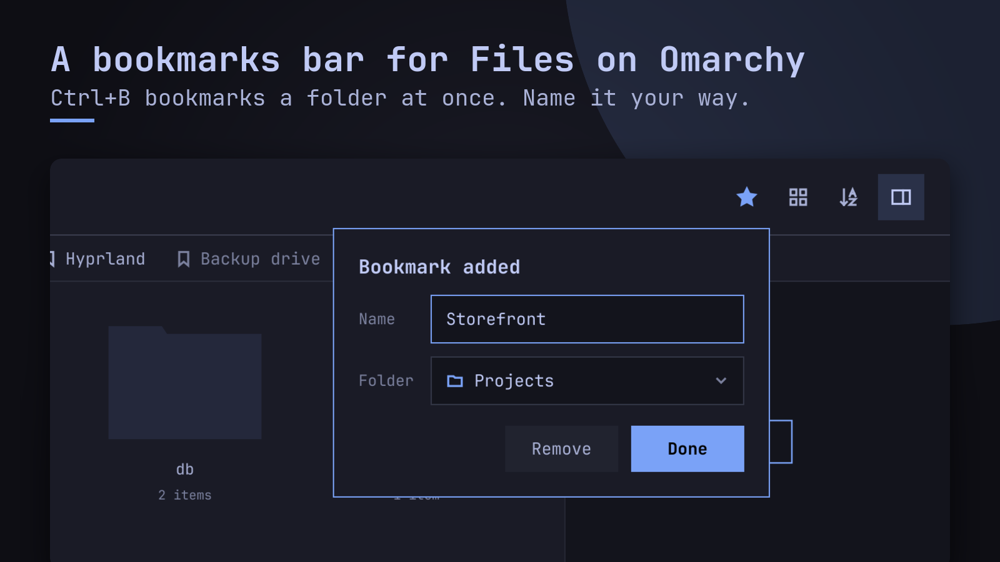
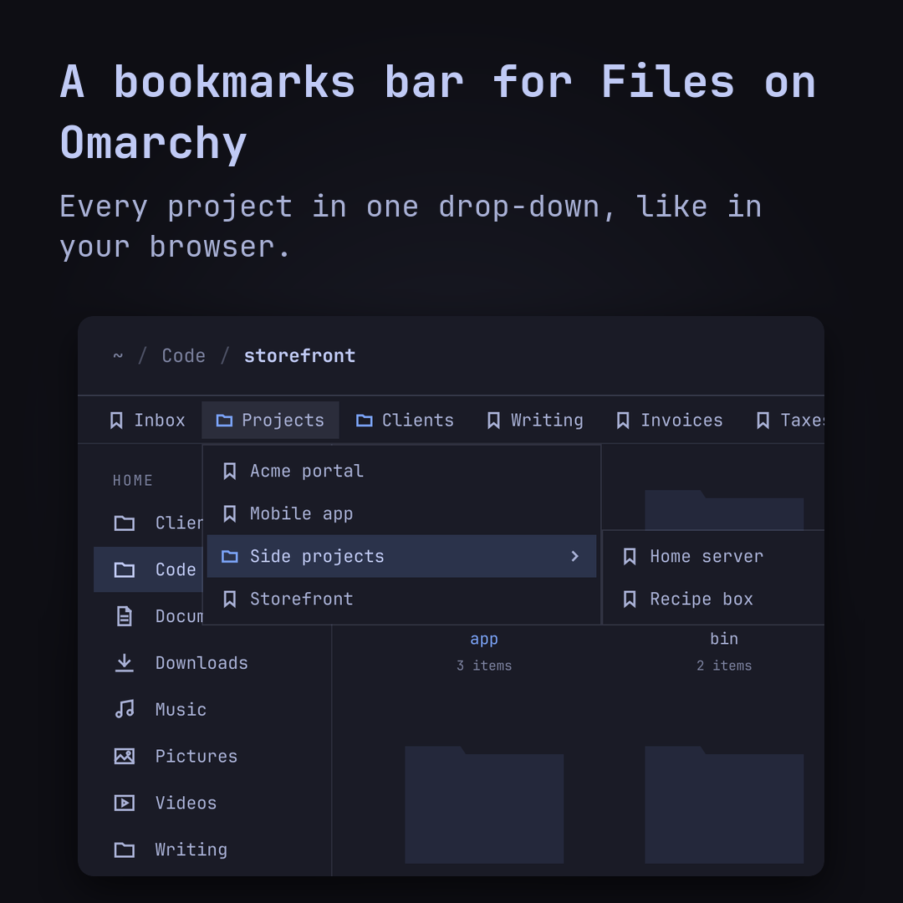
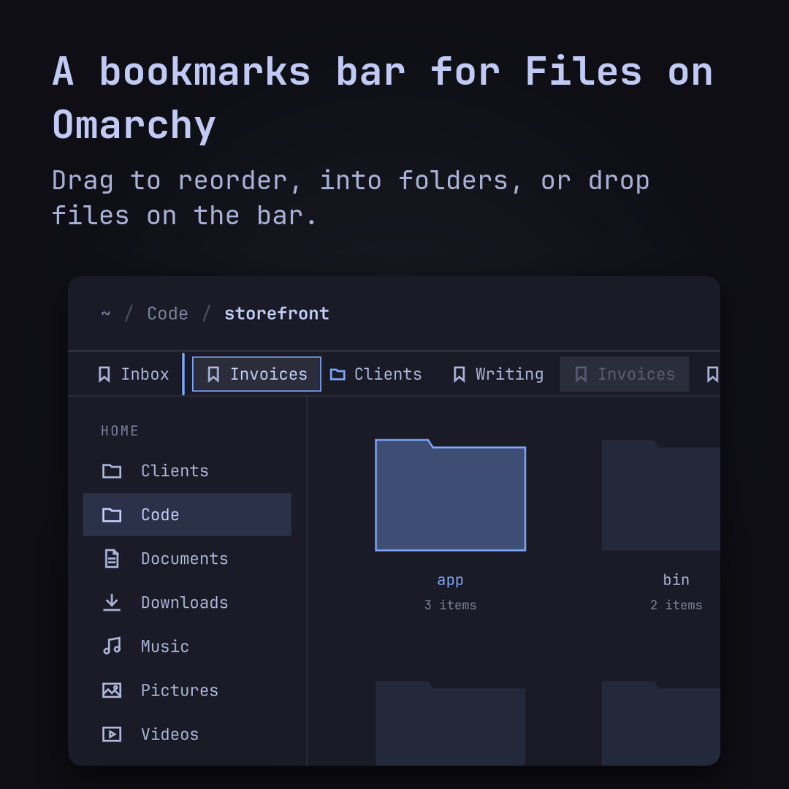
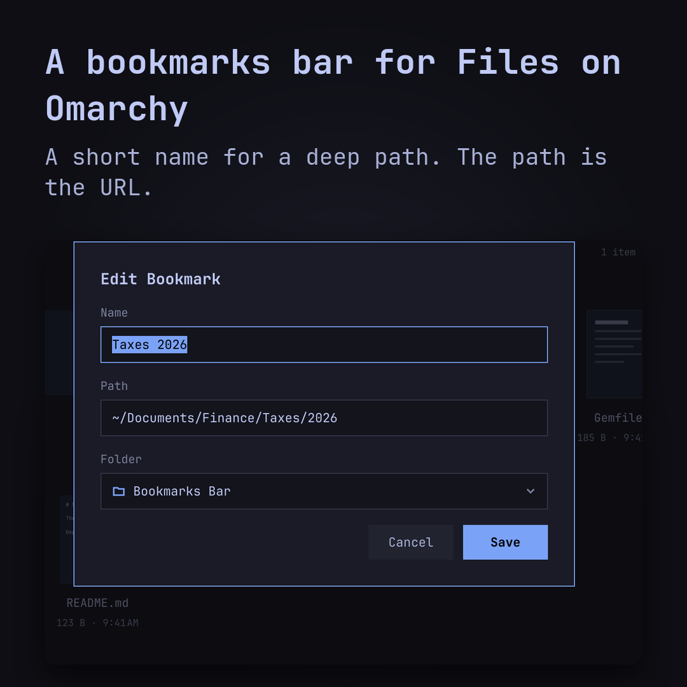

# Files, with a bookmarks bar

Omarchy's file manager, [Files](https://github.com/omacom/folio), plus the one thing every browser
has and file managers don't: **a bookmarks bar**. Everything else is upstream's Files, kept within a
week of `omacom/folio` main.



## Why

The dozen folders you go to all day deserve what the dozen sites do: one click, named the way you
think of them, grouped the way you work. Pins are a flat list of folder names, and two folders
called `assets` (one per client) look the same. A bookmark is named by you, sits in folders of its
own, and its path is just its URL.

## What you get

- **Ctrl+B or the ☆ in the path bar** bookmarks the folder at once; the bubble names it and picks
  its folder. On a bookmarked folder the ★ edits it.
- **The bar under the path**: a click goes there, middle-click opens a new window, folders of
  bookmarks drop down (with folders inside), » holds what doesn't fit.
- **Drag** chips and menu entries to reorder or into folders; drag files and folders in from the
  panes to bookmark them.
- **A short name for a deep path**: Edit… has Name, Path (Tab completes) and Folder. Files open in
  their app; a drive that isn't plugged in stays, dimmed.
- **Keyboard**: F6 to the bar, arrows, Enter, Shift+F10; Ctrl+Shift+B hides it.
- **Safe**: `~/.config/folio-spqrk/bookmarks.json`, locked, re-read and written atomically, so two
  windows never lose each other's changes; a damaged file is never written over.

| Every project in one drop-down | Drag to reorder or into folders | A short name for a deep path |
|---|---|---|
|  |  |  |

Pins and the sidebar stay as they are (Ctrl+P), beside the bar.

## Install on Omarchy

It installs **beside** Omarchy's own Files, as `folio-spqrk` (own binary, settings and plugin
folder), so the two never share a file.

```sh
git clone -b spqrk https://github.com/realspqrk/folio.git ~/Work/folio
cd ~/Work/folio/fork/pkg && makepkg -f && pkexec pacman -U folio-spqrk-*.pkg.tar.zst
```

Make it the default file manager (folders, Super+Shift+F, "Show in folder"): see
[fork/README.md](/fork/README.md#as-the-default-file-manager). Staying current is one command a
week, `folio-sync`: see [the playbook](/fork/playbooks/upstream-sync.md).

## How it stays close to upstream

The `spqrk` branch is `omacom/folio` main plus two commits — the bar, and this fork's packaging and
tooling — rebased weekly, built, and tested (upstream's tests, the bar's model tests, and an
end-to-end run of the real app). `main` mirrors upstream. For everything that isn't the bar, read
[upstream's README](/README.md).

Files is by [omacom](https://github.com/omacom/folio) (MIT). This fork isn't affiliated with Omarchy
or omacom; the bar was proposed upstream in
[omacom/folio#44](https://github.com/omacom/folio/pull/44).
