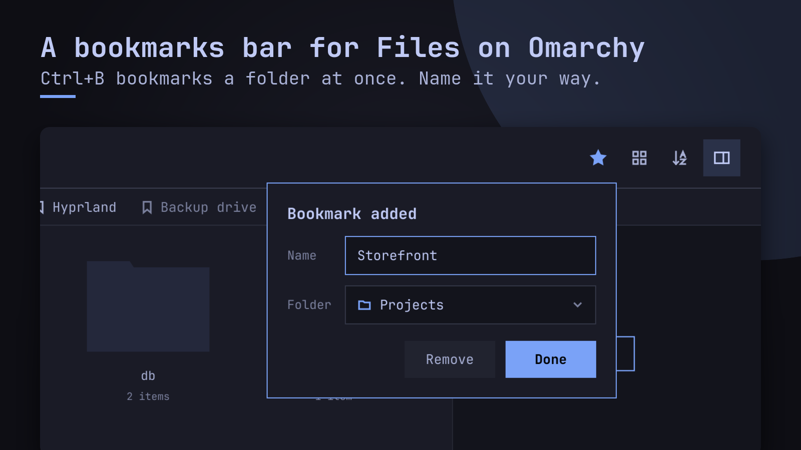

# realspqrk/folio: Files with a bookmarks bar

A fork of [omacom/folio](https://github.com/omacom/folio) (Omarchy's "Files") that adds a
browser-like bookmarks bar. Linux/Omarchy only.

## Side by side with Omarchy's Files

Nothing is shared with the stock `folio` package, so `omarchy update` never touches it:

| | Stock | Fork |
|---|---|---|
| package / binary | `folio` | `folio-spqrk` |
| desktop entry / app id | `folio.desktop`, `folio` | `folio-spqrk.desktop`, `folio-spqrk` |
| preview window app id | `folio-preview` | `folio-spqrk-preview` (float rule in `~/.config/hypr/hyprland.lua`) |
| settings + bookmarks | `~/.config/folio/` | `~/.config/folio-spqrk/` (`bookmarks.json`) |

Shared on purpose: the GTK bookmarks (sidebar pins), thumbnail cache, theme, and
`org.freedesktop.FileManager1` (whichever Files starts first answers "Show in folder").

## As the default file manager

Install: `folio-sync check`, then `folio-sync install` (or `cd fork/pkg && makepkg -f`, then
`pkexec pacman -U <the package>`). Then, all user-level and kept by `omarchy update`:

| What | Where |
|---|---|
| Folders open in it | `xdg-mime default folio-spqrk.desktop inode/directory` (`~/.config/mimeapps.list`) |
| Super+Shift+F, Super+Alt+Shift+F (cwd) | `o.rebind(...)` lines at the end of `~/.config/hypr/bindings.lua` |
| "Show in folder" from other apps | `~/.local/share/dbus-1/services/org.freedesktop.FileManager1.service` (`Exec=/usr/bin/folio-spqrk`) |

Undo: delete the two `o.rebind` lines and the service file, and point `inode/directory` back
(`xdg-mime default folio.desktop inode/directory` once Omarchy ships Files).

## Bookmarks bar

- ☆ in the path bar / **Ctrl+B** bookmarks the folder at once; the "Bookmark added" bubble
  names it and picks its folder (Enter/Esc/click outside keep, Remove undoes). On a
  bookmarked folder the ★ edits it.
- Click goes there (files open in their app); middle/Ctrl+click opens a folder in a new window.
- Folders drop down (nested submenus) and act as a menu bar (click again closes, pointing at
  another folder switches); what doesn't fit goes behind ».
- Drag chips to reorder or into folders, entries inside drop-downs too (and out onto the bar);
  drag files/folders from a pane to bookmark them.
- Right-click (or the menu key / Shift+F10) anywhere, drop-downs included: Open, Open in New
  Window, Show in Folder, Copy Path, Add Bookmark…, New Folder… (beside it), Edit…/Rename…, Delete;
  on the bar: Hide Bookmarks Bar (**Ctrl+Shift+B**; a hidden bar comes back from the files'
  right-click menu).
- **F6** puts the keys on the bar: ←/→, ⏎ (Ctrl+⏎ new window), Escape.
- The bubble remembers the last folder used and can make a new folder in place.
- A bookmark's path is its URL: anything the path bar takes (`~`, `file://`, `recent:`).
  Stored with `~`, so `bookmarks.json` moves between machines; each entry has a stable `id`.
- Safe with several windows: every change locks `bookmarks.json.lock`, re-reads the file and writes
  atomically; a file that isn't valid bookmarks (even an empty one) is never written over.

## Promo screenshots

`fork/promo/promo.sh build/promo` makes social cards from a made-up home; see
[playbooks/promo-screenshots.md](playbooks/promo-screenshots.md). Current cards: `promo/cards/`.

## Staying close to upstream

`spqrk` (the fork's default branch) = `upstream/main` + two commits: the bar (stock identity; new
files plus small hooks) and the fork layer (identity, packaging in `fork/pkg/`, e2e driver, tooling,
docs). The fork's `main` mirrors upstream. Weekly, `folio-sync check` (systemd user timer, Monday
09:00) rebases, builds, tests and packages in its own clone and notifies; `/folio-sync` (Claude
skill) handles conflicts, review, publish and install. Details:
[playbooks/upstream-sync.md](playbooks/upstream-sync.md).

Tests: upstream's `folio_tests`, the bar's `bookmarks_tests` and the e2e steps (`bin/test`). Build:
CMake.
